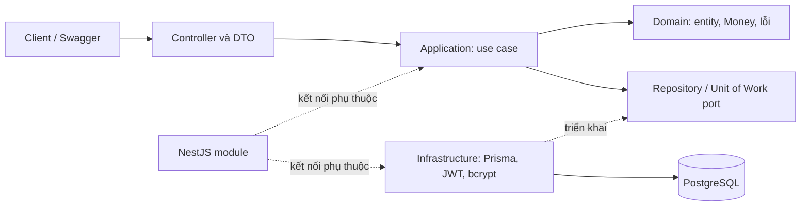

# SA Bank Account

**Dịch vụ backend quản lý tài khoản ngân hàng**, xây dựng cho môn Kiến trúc phần mềm. Dự án cung cấp REST API để đăng ký, đăng nhập, mở tài khoản, nạp/rút, chuyển khoản nội bộ, xem lịch sử và đóng tài khoản.

Trọng tâm của Pha 1 là **tính đúng đắn của số dư và giao dịch khi nhiều yêu cầu chạy đồng thời**. Đây là hệ thống mô phỏng: nạp/rút và tiền gửi ban đầu do hệ thống ghi nhận, chưa kết nối ngân hàng hoặc cổng thanh toán bên ngoài.

> Đọc sâu hơn: [bộ tài liệu dự án](docs/project-guide/README.md). README này trình bày tổng quan; hướng dẫn vận hành và đặc tả chi tiết được tách riêng để dễ tra cứu.

## 1. Bài toán và phạm vi

Một khách hàng có thể sở hữu nhiều tài khoản và thực hiện giao dịch trên từng tài khoản. Nếu hai yêu cầu rút tiền cùng đọc một số dư cũ, hệ thống có thể chi vượt số tiền hiện có. Nếu chuyển khoản chỉ trừ nguồn nhưng chưa cộng đích đã gặp lỗi, dữ liệu sẽ bị lệch. Nếu client gửi lại yêu cầu sau timeout, tiền có thể bị chuyển hai lần.

Dự án giải quyết các tình huống này bằng kiểm tra quyền sở hữu, biểu diễn tiền chính xác, database transaction, khóa dòng tài khoản và khóa chống lặp cho chuyển khoản.

| Nhóm chức năng | Hành vi đã triển khai |
| --- | --- |
| Danh tính | Đăng ký bằng email/mật khẩu; đăng nhập nhận JWT |
| Tài khoản | Mở tài khoản PAYMENT/SAVINGS; xem danh sách, chi tiết, số dư; đóng logic |
| Nạp/rút | Ghi nhận CREDIT/DEBIT và số dư sau giao dịch |
| Chuyển khoản | Chuyển VND giữa hai tài khoản nội bộ, kể cả khác chủ sở hữu |
| Lịch sử | Phân trang; lọc theo loại giao dịch và khoảng thời gian |
| Hỗ trợ tích hợp | Swagger/OpenAPI, response thống nhất, request ID, Docker |

Luồng sử dụng: **đăng ký → đăng nhập → mở tài khoản → nạp/rút/chuyển tiền → xem lịch sử → đưa số dư về 0 → đóng tài khoản**.

Chưa triển khai: tính lãi SAVINGS, phí giao dịch, đa tiền tệ, chuyển liên ngân hàng, MFA, refresh token, quên mật khẩu, nghiệp vụ nhân viên và xử lý bất đồng bộ. Các thư mục placeholder không được xem là tính năng hoàn thành.

## 2. Công nghệ

| Thành phần | Công nghệ trong repository | Vai trò |
| --- | --- | --- |
| Runtime, ngôn ngữ | Node.js 24 trong Docker; TypeScript | Chạy backend và mô hình hóa nghiệp vụ |
| Web framework | NestJS 12, Express adapter | Controller, module, dependency injection |
| Truy cập dữ liệu | Prisma 7, PostgreSQL driver adapter | Repository, transaction và migration |
| Database | PostgreSQL 15 trong Compose | Lưu dữ liệu, khóa dòng và ràng buộc toàn vẹn |
| Xác thực | JWT, bcrypt | Access token và băm mật khẩu |
| Kiểm tra đầu vào | class-validator, class-transformer | Validate body, path và query |
| Tài liệu API | @nestjs/swagger | Swagger UI và OpenAPI JSON |
| Đóng gói, kiểm thử | Docker Compose; Jest; Node test runner | Môi trường chạy, unit/integration và HTTP E2E |

Phiên bản dependency được khai báo trong [package.json](package.json), khóa cụ thể trong `package-lock.json`. Kiểm thử tải chưa có kịch bản chạy được; k6 chưa phải thành phần đã triển khai.

## 3. Kiến trúc tổng quan

Ứng dụng là **modular monolith**: các module nghiệp vụ chạy trong một ứng dụng NestJS, dùng chung PostgreSQL. Bên trong mỗi module, mã được chia theo lớp và dùng port/adapter để tách nghiệp vụ khỏi cách truy cập dữ liệu.



| Module/lớp | Trách nhiệm |
| --- | --- |
| `identity` | Tạo người dùng, kiểm tra mật khẩu, phát JWT |
| `accounts` | Vòng đời tài khoản và quyền sở hữu |
| `money-movement` | Nạp/rút, chuyển khoản, truy vấn lịch sử |
| `presentation` | Nhận HTTP, validate DTO, lấy user từ token, trả response |
| `application` / `domain` | Điều phối nghiệp vụ, tính tiền, kiểm tra điều kiện và khai báo port |
| `infrastructure` | Triển khai port bằng Prisma, PostgreSQL, JWT và bcrypt |
| `common` | Guard, validation, xử lý lỗi, envelope, request ID và logging |

Use case phụ thuộc vào interface thay vì gọi Prisma trực tiếp. Các file `*.module.ts` nối use case với implementation qua dependency injection. Nhờ vậy có thể kiểm thử nghiệp vụ bằng fake repository/unit of work, trong khi các test tích hợp kiểm chứng hành vi database thật.

Guard JWT được đăng ký toàn cục; chỉ đăng ký/đăng nhập được đánh dấu public. Quyền sở hữu được kiểm tra trong nghiệp vụ. Với thao tác tiền, unit of work giữ các cập nhật và bản ghi lịch sử trong cùng một transaction.

```text
src/
  main.ts, app.module.ts       # Khởi động và ghép module
  common/                     # HTTP, bảo mật, cấu hình, Money
  modules/
    identity/
    accounts/
    money-movement/           # Mỗi module có các lớp nêu trên
  infrastructure/prisma/      # Kết nối database
prisma/                       # Schema và migration SQL
test/                         # Unit, integration, HTTP E2E
docs/project-guide/           # Tài liệu chi tiết theo chủ đề
```

Xem [kiến trúc và luồng chuyển khoản](docs/project-guide/01-architecture.md).

## 4. Dữ liệu và quy tắc cốt lõi

| Thực thể | Ý nghĩa | Quan hệ chính |
| --- | --- | --- |
| User | Khách hàng và thông tin đăng nhập | Một user có nhiều tài khoản |
| BankAccount | Số tài khoản, loại, số dư, trạng thái | Thuộc một user; có nhiều giao dịch |
| FinancialTransaction | Một lần ghi tăng/giảm số dư của một tài khoản | Có thể thuộc một Transfer |
| Transfer | Một lệnh chuyển tiền nội bộ | Liên kết nguồn, đích, người thực hiện và hai giao dịch đối ứng |

**Tiền:** chỉ dùng VND nguyên, lưu `DECIMAL(18,0)`, tính bằng `bigint` trong `Money`, gửi qua JSON dưới dạng chuỗi như `"100000"`. Amount giao dịch phải dương; tiền gửi ban đầu có thể bằng `0`. Giá trị tiền lưu trữ tối đa là `999999999999999999`.

**Quyền và trạng thái:** chỉ chủ tài khoản được xem, nạp/rút, xem lịch sử hoặc đóng tài khoản đó. Không tồn tại hoặc không thuộc người gọi đều trả `404`. Tài khoản chỉ được đóng khi số dư bằng `0`; đóng logic thành `CLOSED`, giữ lịch sử. Gọi đóng lại trả `204`. Tài khoản SAVINGS hiện có cùng quy tắc giao dịch cơ bản với PAYMENT, chưa có lãi suất.

**Nhất quán:** cập nhật số dư và ghi lịch sử cùng commit hoặc rollback. Nạp/rút dùng `SELECT ... FOR UPDATE`; chuyển khoản khóa hai tài khoản theo thứ tự ID. Chuyển 100.000 VND từ A sang B tạo một DEBIT ở A và một CREDIT ở B, tổng số dư hai tài khoản không đổi. Quy tắc bảo toàn này áp dụng cho chuyển nội bộ; nạp/rút làm thay đổi tổng tiền mô phỏng trong hệ thống.

**Chống lặp:** transfer dùng cặp duy nhất `(sourceAccountId, idempotencyKey)`. Lần đầu trả `201`, gửi lại cùng key và payload trả kết quả cũ với `200`. Hiện chưa so sánh payload khi key được dùng lại; client phải giữ nguyên thông tin chuyển tiền khi retry. Nạp/rút chưa có cơ chế này.

**Bảo vệ dữ liệu:** mật khẩu được băm bằng bcrypt; response không chứa password hash. API không có chức năng sửa/xóa giao dịch đã ghi nhận. CHECK constraint bổ sung hàng rào tại DB, nhưng không biến database thành sổ cái bất biến trước mọi thao tác SQL trực tiếp.

Xem [database và ERD](docs/project-guide/02-database.md), [nghiệp vụ và tình huống biên](docs/project-guide/04-business-rules.md).

## 5. Endpoint và quy ước API

Base URL mặc định: `http://localhost:3000/api/v1`. Body dùng JSON; các endpoint bảo vệ yêu cầu `Authorization: Bearer <accessToken>`.

| Method | Path sau `/api/v1` | JWT | Mục đích / kết quả |
| --- | --- | --- | --- |
| POST | `/auth/register` | Không | Tạo user — 201 |
| POST | `/auth/login` | Không | Nhận access token và user — 200 |
| POST | `/accounts` | Có | Mở tài khoản — 201 |
| GET | `/accounts` | Có | Danh sách tài khoản của mình — 200 |
| GET | `/accounts/{accountId}` | Có | Chi tiết tài khoản — 200 |
| DELETE | `/accounts/{accountId}` | Có | Đóng tài khoản — 204, body rỗng |
| POST | `/accounts/{accountId}/transactions` | Có | Nạp CREDIT hoặc rút DEBIT — 201 |
| GET | `/accounts/{accountId}/transactions` | Có | Lịch sử có phân trang — 200 |
| POST | `/transfers` | Có | Chuyển tiền — 201 mới / 200 replay |

Ví dụ body mở tài khoản:

```json
{ "accountName": "Chi tiêu", "accountType": "PAYMENT", "initialDeposit": "500000" }
```

Ví dụ body chuyển khoản; thay UUID nguồn và số tài khoản đích bằng dữ liệu đã tạo. Gửi thêm header `Idempotency-Key: transfer-demo-20261027-001` (16–128 ký tự sau trim):

```json
{
  "sourceAccountId": "81ed4895-3bc6-46c9-b7b2-c0e86b978a10",
  "destinationAccountNumber": "100000012345",
  "amount": "100000",
  "description": "Thanh toán nội bộ"
}
```

Đích chuyển khoản được nhập bằng **số tài khoản** (`destinationAccountNumber`), còn nguồn dùng **ID nội bộ** (`sourceAccountId`). Client không tự gửi `userId`, `currentBalance` hoặc `accountNumber` khi mở tài khoản; field ngoài DTO bị từ chối.

Response thành công có dạng `{ "success": true, "data": ..., "meta": { "requestId": "..." } }`. Danh sách có thêm `pagination` cùng cấp với `data`, gồm `page`, `limit`, `total`, `totalPages`. Mặc định trang 1, mỗi trang 20 bản ghi; tối đa 100.

Ví dụ lỗi:

```json
{
  "success": false,
  "error": { "code": "INSUFFICIENT_FUNDS", "message": "Insufficient funds" },
  "meta": { "requestId": "demo-request-id" }
}
```

Lỗi có thể kèm `error.details`. Header `X-Request-Id` giúp đối chiếu response với log. Mã HTTP chính: `400` dữ liệu sai, `401` xác thực thất bại, `404` không tìm thấy/không sở hữu, `409` xung đột nghiệp vụ, `500` lỗi nội bộ với thông báo an toàn.

Hợp đồng từng endpoint, bộ lọc và ví dụ response: [API chi tiết](docs/project-guide/03-api.md). Khi chạy ở môi trường không phải production, mở [Swagger UI](http://localhost:3000/api/docs) hoặc [OpenAPI JSON](http://localhost:3000/api/docs.json).

## 6. Khởi chạy nhanh

Cần Git và Docker có Compose v2. Các lệnh dưới đây dùng PowerShell, chạy tại thư mục gốc repository:

```powershell
# Chỉ sao chép khi chưa có .env:
if (-not (Test-Path .env)) { Copy-Item .env.example .env }
```

Sửa `.env`: điền `DB_USER`, `DB_PASSWORD`, `DB_NAME` và secret riêng cho `JWT_ACCESS_SECRET`; bảo đảm `DOCKER_DATABASE_URL` trỏ tới `postgres:5432` với đúng thông tin DB. Đặt `NODE_ENV=development` nếu muốn xem Swagger. Không commit secret.

```powershell
docker compose up --build -d --wait --wait-timeout 180
docker compose ps -a
```

Compose khởi động PostgreSQL, chạy migration rồi mới chạy app. Trạng thái mong đợi: `postgres` healthy, `migrate` exit 0, `app` healthy. API mặc định ở cổng 3000; `APP_PORT` đổi cổng trên host. Swagger hiện phụ thuộc `NODE_ENV`; biến `ENABLE_SWAGGER` trong file mẫu chưa được sử dụng.

Để demo: đăng ký và đăng nhập trong Swagger, lấy `data.accessToken`, bấm **Authorize**, tạo hai tài khoản rồi thử nạp/rút/chuyển tiền và đọc lịch sử. Chỉ đóng khi số dư đã về `0`.

```powershell
docker compose logs --tail 100 app migrate
docker compose down
```

`down` giữ dữ liệu trong volume. Hướng dẫn chạy Node.js trên host, cấu hình URL database và script demo PowerShell: [chạy dự án](docs/project-guide/05-running.md).

## 7. Kiểm thử, giới hạn và tài liệu

Repository có unit test bằng Jest, integration test với PostgreSQL, test hợp đồng Swagger và 6 ca HTTP E2E bằng Node test runner. Test mặc định chỉ chạy unit; integration/E2E cần database riêng có tên kết thúc bằng `_test`.

```powershell
npm ci
npx prisma generate
npm test -- --runInBand
npm run test:swagger
```

Xem [hướng dẫn kiểm thử](docs/project-guide/06-testing.md) để chuẩn bị DB và chạy integration/E2E. Kiểm thử tải trên Kaggle CPU theo đề bài chưa hoàn thành; chưa có số liệu throughput/latency để kết luận hiệu năng. Healthcheck Docker hiện kiểm tra ứng dụng trả `401` ở route bảo vệ, chưa kiểm tra liên tục khả năng kết nối DB.

| Muốn tìm hiểu | Tài liệu |
| --- | --- |
| Ranh giới module, dependency, luồng xử lý | [Kiến trúc](docs/project-guide/01-architecture.md) |
| ERD, bảng, khóa, constraint, tính nhất quán | [Database](docs/project-guide/02-database.md) |
| Request, response, validation, lỗi | [API](docs/project-guide/03-api.md) |
| Use case, quy tắc tiền, retry, đóng tài khoản | [Nghiệp vụ](docs/project-guide/04-business-rules.md) |
| Docker, chạy local, demo và kiểm thử | [Chạy dự án](docs/project-guide/05-running.md) · [Kiểm thử](docs/project-guide/06-testing.md) |
| Nhận xét tài liệu giới thiệu ban đầu | [Đánh giá introduce.md](docs/project-guide/07-introduce-review.md) |

[Đề bài gốc](docs/phase1_document/Requirement.md) và [đặc tả Pha 1](docs/phase1_document/phase1-scope-reduced.md) được giữ để đối chiếu yêu cầu. Bộ `project-guide` mô tả mã hiện tại; tài liệu thiết kế gốc có thể đề cập các chức năng chưa triển khai.
