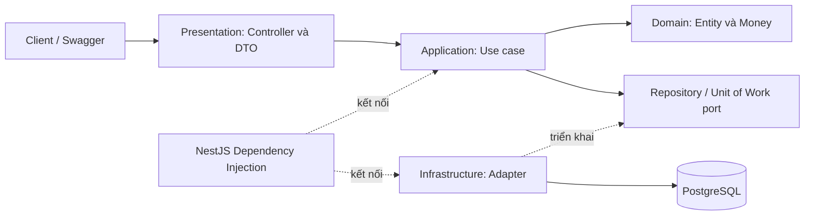

# SA Bank Account

**Backend quản lý tài khoản ngân hàng và giao dịch nội bộ**, cung cấp REST API cho toàn bộ vòng đời từ đăng ký khách hàng, mở tài khoản đến nạp/rút, chuyển tiền và tra cứu lịch sử.

Hệ thống tập trung giải quyết bài toán cốt lõi về **tính toàn vẹn số dư và giao dịch đồng thời trong môi trường mô phỏng độc lập (sandbox)**. Kiến trúc modular monolith áp dụng các nguyên tắc Clean Architecture và Hexagonal Architecture (Ports & Adapters), giúp tổ chức nghiệp vụ rõ ràng, kiểm thử độc lập và quản lý các thao tác tiền trong cùng một database transaction.

[Khởi chạy nhanh](#5-khởi-chạy-nhanh) · [Danh sách API](#4-api-chính) · [Tài liệu chi tiết](docs/project-guide/README.md)

## 1. Bài toán và tính năng

Một khách hàng có thể sở hữu nhiều tài khoản, theo dõi số dư và chuyển tiền giữa các tài khoản. Thách thức nằm ở việc giữ dữ liệu nhất quán: hai yêu cầu rút tiền đồng thời phải sử dụng đúng số dư khả dụng; một lệnh chuyển khoản phải hoàn tất cả trừ nguồn và cộng đích; việc gửi lại lệnh sau timeout phải được xử lý có kiểm soát.

SA Bank Account kết hợp kiểm tra quyền sở hữu, tính toán tiền chính xác, khóa dòng và giao dịch nguyên tử để xử lý các tình huống này.

| Nhóm chức năng | Tính năng cung cấp |
| --- | --- |
| Danh tính khách hàng | Đăng ký bằng email/mật khẩu, đăng nhập và nhận JWT |
| Quản lý tài khoản | Mở tài khoản PAYMENT/SAVINGS, xem danh sách, chi tiết và số dư |
| Nạp và rút tiền | Ghi nhận khoản tăng/giảm cùng số dư sau mỗi giao dịch |
| Chuyển khoản | Chuyển tiền giữa hai tài khoản nội bộ, kể cả khác chủ sở hữu |
| Tra cứu lịch sử | Phân trang, lọc theo chiều giao dịch và khoảng thời gian |
| Đóng tài khoản | Đóng logic khi số dư bằng 0, giữ lại lịch sử để tra cứu |
| Tích hợp | REST API, Swagger/OpenAPI, response thống nhất và request ID |

**Phạm vi thiết kế:** giao dịch nội bộ bằng VND trong sandbox; nạp/rút và tiền gửi ban đầu được mô phỏng trong hệ thống. PAYMENT và SAVINGS dùng chung các quy tắc giao dịch cơ bản.

Luồng sử dụng điển hình: **đăng ký → đăng nhập → mở tài khoản → nạp/rút/chuyển tiền → xem lịch sử → đóng tài khoản**.

## 2. Công nghệ

| Thành phần | Công nghệ | Vai trò |
| --- | --- | --- |
| Ngôn ngữ và runtime | TypeScript, Node.js 24 | Xây dựng backend và mô hình hóa nghiệp vụ |
| Web framework | NestJS 12, Express adapter | Controller, module và dependency injection |
| Truy cập dữ liệu | Prisma 7 | Repository, transaction và migration |
| Cơ sở dữ liệu | PostgreSQL 15 | Lưu trữ, khóa dòng và ràng buộc toàn vẹn |
| Xác thực | JWT, bcrypt | Access token và băm mật khẩu |
| Validation | class-validator, class-transformer | Kiểm tra và chuyển đổi dữ liệu đầu vào |
| Tài liệu API | Swagger / OpenAPI | Khám phá và thử API trực tiếp |
| Đóng gói | Docker, Docker Compose | Khởi chạy ứng dụng cùng database |
| Kiểm thử | Jest, Node test runner, k6 | Unit, integration, hợp đồng API, HTTP E2E và tải trên Kaggle CPU |

Node.js và PostgreSQL trong bảng tương ứng với môi trường Docker của dự án. Dependency được khai báo trong [package.json](package.json) và khóa phiên bản trong [package-lock.json](package-lock.json).

## 3. Kiến trúc và các cơ chế cốt lõi

### Tổ chức hệ thống

Ứng dụng sử dụng **modular monolith**: ba module nghiệp vụ chạy trong một ứng dụng NestJS và dùng chung PostgreSQL. Bên trong các module, dự án áp dụng các nguyên tắc của **Clean Architecture** và **Hexagonal Architecture (Ports & Adapters)**:

- **Clean Architecture:** phân chia presentation, application, domain và infrastructure; logic nghiệp vụ hướng vào domain và không phụ thuộc trực tiếp vào NestJS hay Prisma.
- **Hexagonal Architecture:** các port định nghĩa hợp đồng mà use case cần; adapter triển khai các hợp đồng đó bằng công nghệ cụ thể. Controller HTTP là điểm tiếp nhận yêu cầu từ bên ngoài.

Modular monolith mô tả cách tổ chức và triển khai hệ thống; hai nguyên tắc còn lại mô tả cách tổ chức mã và quản lý dependency bên trong ứng dụng.



| Module | Trách nhiệm |
| --- | --- |
| `identity` | Quản lý thông tin đăng nhập, kiểm tra mật khẩu và phát JWT |
| `accounts` | Quản lý tài khoản, quyền sở hữu và vòng đời ACTIVE → CLOSED |
| `money-movement` | Điều phối nạp/rút, chuyển khoản và truy vấn lịch sử |

Controller tiếp nhận và kiểm tra request trước khi gọi use case. Use case thực hiện quy tắc nghiệp vụ thông qua các port; adapter hiện thực các port bằng Prisma, JWT hoặc bcrypt. NestJS module kết nối các thành phần qua dependency injection.

Cách phân chia này giúp nghiệp vụ có thể được kiểm thử bằng fake repository/unit of work, đồng thời giữ các kiểm thử database thật ở lớp tích hợp. Các thành phần dùng chung như guard, validation, xử lý lỗi và logging được tập trung trong `common`.

### Bảo đảm tính nhất quán giao dịch

| Cơ chế | Cách áp dụng | Ý nghĩa |
| --- | --- | --- |
| **Atomic transaction** | Cập nhật số dư và ghi lịch sử trong cùng DB transaction | Các thay đổi cùng thành công hoặc cùng rollback |
| **Row-level locking** | Khóa dòng tài khoản khi nạp/rút; khóa hai tài khoản theo thứ tự ID khi chuyển tiền | Kiểm soát truy cập đồng thời và giảm nguy cơ deadlock |
| **Idempotency** | Áp dụng chuyên biệt cho chuyển khoản theo cặp `(sourceAccountId, idempotencyKey)` | Gửi lại cùng key và payload nhận kết quả đã ghi nhận |
| **Biểu diễn tiền chính xác** | Tính toán tiền nguyên, truyền giá trị tiền qua API bằng string | Tránh sai số số thực |
| **Quyền sở hữu** | Xác thực JWT tập trung, kiểm tra chủ tài khoản tại nghiệp vụ | Giới hạn thao tác theo người dùng đã xác thực |
| **Ràng buộc dữ liệu** | Khóa ngoại, unique và CHECK constraint tại PostgreSQL | Bảo vệ quan hệ và các điều kiện hợp lệ của dữ liệu |

Ví dụ, chuyển 100.000 VND từ A sang B tạo một giao dịch ghi giảm ở A và một giao dịch ghi tăng ở B. Hai số dư, lệnh chuyển tiền và hai bản ghi lịch sử nằm trong cùng transaction, giữ nguyên tổng tiền của hai tài khoản sau chuyển khoản.

Mô hình dữ liệu xoay quanh **User → BankAccount → FinancialTransaction**; **Transfer** liên kết tài khoản nguồn, đích và hai giao dịch đối ứng. Mỗi giao dịch lưu số dư sau khi thực hiện, phục vụ tra cứu diễn biến tiền. Khi tài khoản được đóng, dữ liệu và lịch sử vẫn được giữ lại.

Chi tiết ranh giới module và luồng xử lý nằm trong [tài liệu kiến trúc](docs/project-guide/01-architecture.md). ERD và các ràng buộc được trình bày tại [tài liệu database](docs/project-guide/02-database.md).

## 4. API chính

Base URL mặc định: `http://localhost:3000/api/v1`. API sử dụng JSON; các endpoint bảo vệ yêu cầu header `Authorization: Bearer <accessToken>`.

| Method | Endpoint sau `/api/v1` | JWT | Chức năng | Thành công |
| --- | --- | --- | --- | --- |
| POST | `/auth/register` | Không | Đăng ký khách hàng | 201 |
| POST | `/auth/login` | Không | Đăng nhập, nhận access token | 200 |
| POST | `/accounts` | Có | Mở tài khoản | 201 |
| GET | `/accounts` | Có | Danh sách tài khoản của mình | 200 |
| GET | `/accounts/{accountId}` | Có | Chi tiết và số dư tài khoản | 200 |
| DELETE | `/accounts/{accountId}` | Có | Đóng tài khoản | 204 |
| POST | `/accounts/{accountId}/transactions` | Có | Nạp hoặc rút tiền | 201 |
| GET | `/accounts/{accountId}/transactions` | Có | Tra cứu lịch sử giao dịch | 200 |
| POST | `/transfers` | Có | Chuyển khoản nội bộ | 201 mới / 200 gửi lại |

Chuyển khoản nhận ID tài khoản nguồn, số tài khoản đích và header `Idempotency-Key`. Khi thử lại một lệnh chuyển tiền, client giữ nguyên key và toàn bộ payload.

Response được chuẩn hóa cho dữ liệu thành công, phân trang và lỗi. Request ID giúp liên kết phản hồi với log để tra cứu một yêu cầu. Riêng thao tác đóng tài khoản thành công trả `204` với body rỗng.

Xem [hợp đồng API](docs/project-guide/03-api.md) để tra cứu request/response, validation, bộ lọc, mã lỗi và quy tắc retry. Có thể thử trực tiếp bằng [Swagger UI](http://localhost:3000/api/docs) sau khi khởi chạy ở chế độ development.

## 5. Khởi chạy nhanh

Cần **Git và Docker có Compose v2**. Các lệnh dưới đây dùng PowerShell; Docker cung cấp môi trường Node.js và PostgreSQL cho ứng dụng.

### Chuẩn bị cấu hình

```powershell
git clone https://github.com/HUY-TD16/SA_BankAccount.git
cd SA_BankAccount
if (-not (Test-Path .env)) { Copy-Item .env.example .env }
```

Nếu đã có mã nguồn, chạy lệnh tạo `.env` tại thư mục gốc dự án. Cấu hình các giá trị sau trước khi khởi động:

| Biến | Cấu hình |
| --- | --- |
| `DB_USER`, `DB_PASSWORD`, `DB_NAME` | Thông tin database cho môi trường chạy |
| `DOCKER_DATABASE_URL` | Kết nối tới `postgres:5432`, dùng cùng thông tin database ở trên |
| `JWT_ACCESS_SECRET` | Secret riêng để ký access token |
| `NODE_ENV` | Đặt `development` để sử dụng Swagger |
| `APP_PORT` | Cổng HTTP trên host, mặc định `3000` |

Giữ secret trong cấu hình môi trường và không commit `.env`. Hướng dẫn URL kết nối, chạy Node.js trên host và xử lý lỗi cấu hình nằm trong [hướng dẫn chạy dự án](docs/project-guide/05-running.md).

### Khởi động và trải nghiệm API

```powershell
docker compose up --build -d --wait --wait-timeout 180
docker compose ps -a
```

Compose khởi động PostgreSQL, áp dụng migration rồi chạy ứng dụng. Trạng thái mong đợi: `postgres` healthy, `migrate` exit 0 và `app` healthy.

Với cổng mặc định, truy cập [Swagger UI](http://localhost:3000/api/docs) hoặc [OpenAPI JSON](http://localhost:3000/api/docs.json). Trong Swagger:

1. Đăng ký và đăng nhập để lấy `data.accessToken`.
2. Bấm **Authorize**, nhập access token.
3. Tạo hai tài khoản, thử nạp/rút và chuyển tiền giữa chúng.
4. Xem số dư, lịch sử; đưa số dư về 0 trước khi đóng tài khoản.

```powershell
# Xem log ứng dụng và migration
docker compose logs --tail 100 app migrate
# Dừng môi trường; dữ liệu vẫn được giữ trong volume
docker compose down
```

## 6. Kiểm thử

Các bộ kiểm thử được tổ chức theo phạm vi trách nhiệm:

| Bộ kiểm thử | Nội dung |
| --- | --- |
| Unit | Quy tắc nghiệp vụ và các thành phần riêng lẻ |
| Integration | Repository, transaction và constraint trên PostgreSQL |
| Swagger contract | Hợp đồng OpenAPI được sinh từ mã nguồn |
| HTTP E2E | Luồng sử dụng qua HTTP, xác thực, ownership và replay chuyển khoản |
| Tải trên Kaggle CPU | Login, list account và debit đồng thời; đo throughput, p50/p95/p99, error rate, CPU/RAM API và kiểm tra số dư |

Để chạy unit test và kiểm tra hợp đồng Swagger trên host có Node.js 24:

```powershell
npm ci
npx prisma generate
npm test -- --runInBand
npm run test:swagger
```

Integration và HTTP E2E sử dụng database riêng có tên kết thúc bằng `_test`. Các bước chuẩn bị môi trường và lệnh chạy từng bộ nằm trong [hướng dẫn kiểm thử](docs/project-guide/06-testing.md).

### Kết quả kiểm thử tải trên Kaggle CPU

Notebook kiểm thử tải Pha 1 hiện dùng PostgreSQL **15**, cùng phiên bản lớn với Docker. Xem [kịch bản và kết quả](docs/performance/phase1-load-test.md), [notebook chạy trên Kaggle](docs/performance/kaggle-load-test.ipynb), [script k6](test/performance/kaggle-load.js) và [cấu hình test](test/performance/protocol.json). Bản vá thực tế được ghi trong `environment.json` của mỗi lần chạy.

Kết quả Kaggle ngày **28/10/2026 (UTC)** được đo trên PostgreSQL **15.19**, CPU **Intel Xeon @ 2.20 GHz**, quota **4 CPU** và giới hạn RAM **30 GiB**: **27 lượt chính thức**, tổng **76.960 request**, error rate **0%** và kiểm tra số dư sau tải đều đạt. Dữ liệu gốc nằm trong [ZIP kết quả](docs/performance/bank-test-20261028-163024-full.zip).

Mỗi mức tải đo **60 giây/lượt**, làm nóng riêng **10 giây**, lặp **3 lần**. Bảng lấy **median từng chỉ số qua ba lần chạy**, không tính lại percentile trên dữ liệu gộp. VU là số client ảo hoạt động đồng thời.

| Bài test | VU | Request/giây | p50 (ms) | p95 (ms) | p99 (ms) | CPU API (%) |
|---|---:|---:|---:|---:|---:|---:|
| Đăng nhập | 1 | 2,50 | 297,08 | 309,99 | 321,65 | 74,18 |
| Đăng nhập | 5 | 10,86 | 352,83 | 388,96 | 422,55 | 369,32 |
| Đăng nhập | 20 | 11,34 | 1.649,11 | 1.736,08 | 1.783,00 | 388,99 |
| Xem tài khoản | 1 | 9,49 | 3,89 | 4,37 | 4,91 | 3,64 |
| Xem tài khoản | 5 | 47,17 | 4,49 | 6,19 | 8,61 | 14,80 |
| Xem tài khoản | 20 | 188,60 | 4,27 | 7,40 | 15,70 | 49,54 |
| Rút tiền | 1 | 8,88 | 11,11 | 13,12 | 16,57 | 6,11 |
| Rút tiền | 5 | 44,52 | 10,76 | 13,25 | 21,30 | 24,82 |
| Rút tiền | 20 | 99,44 | 44,74 | 324,30 | 582,51 | 61,80 |

CPU 100% tương đương một CPU logic; login ở 20 VU sử dụng khoảng **3,89 CPU**. RSS của API cao nhất quan sát được là **445,18 MiB**.

## 7. Khám phá mã nguồn và tài liệu

```text
src/
  main.ts, app.module.ts       # Khởi động và ghép các module
  modules/
    identity/                 # Danh tính và xác thực
    accounts/                 # Vòng đời tài khoản
    money-movement/           # Giao dịch tiền và lịch sử
  common/                     # HTTP, bảo mật, cấu hình và Money
  infrastructure/prisma/      # Kết nối database dùng chung
prisma/                       # Schema và migration
test/                         # Các bộ kiểm thử
docs/project-guide/           # Hướng dẫn chuyên sâu
```

| Tài liệu | Nội dung |
| --- | --- |
| [Kiến trúc](docs/project-guide/01-architecture.md) | Phân tầng, dependency injection, ranh giới module và luồng chuyển khoản |
| [Database](docs/project-guide/02-database.md) | ERD, bảng dữ liệu, khóa, index và constraint |
| [API](docs/project-guide/03-api.md) | Hợp đồng endpoint, ví dụ request/response và xử lý lỗi |
| [Nghiệp vụ](docs/project-guide/04-business-rules.md) | Use case, quy tắc tiền, vòng đời tài khoản và tình huống đồng thời |
| [Chạy dự án](docs/project-guide/05-running.md) | Docker, cấu hình local và kịch bản demo |
| [Kiểm thử](docs/project-guide/06-testing.md) | Chuẩn bị môi trường và thực thi các bộ test |
| [Kiểm thử tải Pha 1](docs/performance/phase1-load-test.md) | Kịch bản Kaggle CPU, kết quả đo và ZIP dữ liệu gốc |
