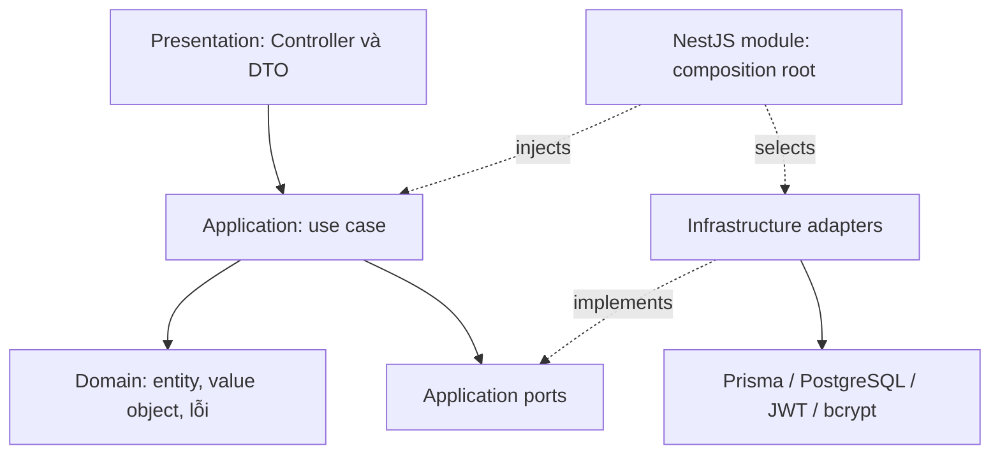
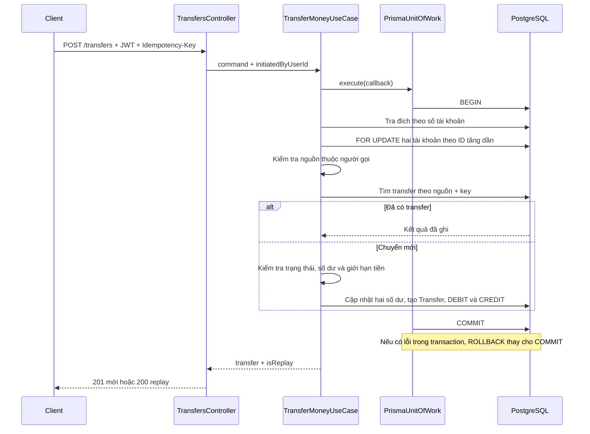

# Kiến trúc hệ thống

[Mục lục](README.md) · [README dự án](../../README.md)

## 1. Kiểu kiến trúc

SA Bank Account là **modular monolith**: một ứng dụng NestJS chứa ba module nghiệp vụ và dùng chung một PostgreSQL. Bên trong ứng dụng, mã nguồn áp dụng các nguyên tắc của **Clean Architecture** và **Hexagonal Architecture (Ports & Adapters)**:

- **Clean Architecture:** phân chia presentation, application, domain và infrastructure. Use case và domain không import NestJS hay Prisma; module NestJS kết nối các thành phần bằng dependency injection.
- **Hexagonal Architecture:** controller HTTP tiếp nhận yêu cầu và gọi use case; các port định nghĩa hợp đồng mà nghiệp vụ cần, còn adapter hiện thực hợp đồng bằng Prisma, JWT hoặc bcrypt. Ví dụ, `UnitOfWorkPort` được triển khai bởi `PrismaUnitOfWork`.

Các module được triển khai cùng ứng dụng và sử dụng chung database. Khi chuyển khoản, việc cập nhật số dư nguồn, số dư đích và ghi lịch sử được thực hiện trong cùng một database transaction.

## 2. Ranh giới module

| Module | Thành phần chính | Trách nhiệm |
| --- | --- | --- |
| identity | AuthController; RegisterUserUseCase; LoginUseCase | Đăng ký, xác thực mật khẩu, trả JWT |
| accounts | AccountsController; Open/List/Get/CloseAccountUseCase | Quản lý vòng đời tài khoản |
| money-movement | TransactionController; TransfersController; Deposit/Withdraw/Transfer/GetTransactionHistoryUseCase | Điều phối tiền và lịch sử |
| common | Money, AccessTokenGuard, filter, pipe, interceptor, logger | Quy ước dùng chung xuyên module |
| infrastructure/prisma | PrismaService, PrismaModule | Cung cấp kết nối DB và Prisma Client |

[AppModule](../../src/app.module.ts) ghép ba module nghiệp vụ cùng các module cấu hình, logging và kết nối database. Việc tra tài khoản đích theo số tài khoản được thực hiện trong luồng chuyển khoản.

## 3. Cấu trúc đầy đủ thư mục src

Cây dưới đây liệt kê toàn bộ thư mục và file trong `src`, bao gồm các file `index.ts`.

```text
src/
├── common/  # Thành phần dùng chung
│   ├── config/  # Cấu hình ứng dụng và biến môi trường
│   │   ├── app.config.ts
│   │   ├── database.config.ts
│   │   ├── env.schema.ts
│   │   ├── index.ts
│   │   └── jwt.config.ts
│   ├── domain/  # Money và lỗi dùng chung
│   │   ├── errors/
│   │   │   ├── app.error.ts
│   │   │   ├── common.errors.ts
│   │   │   └── index.ts
│   │   └── value-objects/
│   │       ├── index.ts
│   │       └── money.value-object.ts
│   ├── http/  # Xử lý HTTP và tài liệu Swagger
│   │   ├── filters/
│   │   │   ├── global-exception.filter.ts
│   │   │   └── index.ts
│   │   ├── interceptors/
│   │   │   ├── http-logging.interceptor.ts
│   │   │   ├── index.ts
│   │   │   └── response-envelope.interceptor.ts
│   │   ├── middleware/
│   │   │   ├── index.ts
│   │   │   └── request-id.middleware.ts
│   │   ├── pipes/
│   │   │   ├── index.ts
│   │   │   └── validation-pipe.factory.ts
│   │   └── swagger/
│   │       ├── response.schemas.ts
│   │       └── swagger.config.ts
│   ├── observability/  # Logging
│   │   ├── index.ts
│   │   ├── logger.service.ts
│   │   └── observability.module.ts
│   └── security/  # Guard, decorator và port xác thực
│       ├── decorators/
│       │   ├── current-user.decorator.ts
│       │   ├── index.ts
│       │   └── public.decorator.ts
│       ├── guards/
│       │   ├── access-token.guard.ts
│       │   └── index.ts
│       └── ports/
│           ├── index.ts
│           └── token-service.port.ts
├── infrastructure/  # Hạ tầng dùng chung
│   └── prisma/  # Prisma Client và kết nối database
│       ├── index.ts
│       ├── prisma.module.ts
│       └── prisma.service.ts
├── modules/  # Các module theo nghiệp vụ
│   ├── accounts/  # Quản lý tài khoản
│   │   ├── application/
│   │   │   ├── ports/
│   │   │   │   ├── account.repository.port.ts
│   │   │   │   ├── accounts.facade.ts
│   │   │   │   └── index.ts
│   │   │   └── use-cases/
│   │   │       ├── close-account.use-case.ts
│   │   │       ├── get-account.use-case.ts
│   │   │       ├── index.ts
│   │   │       ├── list-accounts.use-case.ts
│   │   │       └── open-account.use-case.ts
│   │   ├── domain/
│   │   │   ├── entities/
│   │   │   │   ├── bank-account.entity.ts
│   │   │   │   └── index.ts
│   │   │   ├── enums/
│   │   │   │   ├── account-status.ts
│   │   │   │   ├── account-type.ts
│   │   │   │   └── index.ts
│   │   │   └── errors/
│   │   │       ├── account-has-balance.error.ts
│   │   │       └── account-not-found.error.ts
│   │   ├── infrastructure/
│   │   │   ├── adapters/
│   │   │   │   └── account-lookup.facade.ts
│   │   │   └── persistence/
│   │   │       ├── index.ts
│   │   │       └── prisma-account.repository.ts
│   │   ├── presentation/
│   │   │   └── http/
│   │   │       ├── dto/
│   │   │       │   ├── account-id-params.dto.ts
│   │   │       │   ├── account-response.schema.ts
│   │   │       │   ├── list-accounts-query.dto.ts
│   │   │       │   └── open-account.dto.ts
│   │   │       ├── accounts.controller.ts
│   │   │       └── index.ts
│   │   └── accounts.module.ts
│   ├── identity/  # Danh tính và xác thực
│   │   ├── application/
│   │   │   ├── ports/
│   │   │   │   ├── index.ts
│   │   │   │   ├── password-hasher.port.ts
│   │   │   │   └── user.repository.port.ts
│   │   │   └── use-cases/
│   │   │       ├── index.ts
│   │   │       ├── login.use-case.ts
│   │   │       └── register-user.use-case.ts
│   │   ├── domain/
│   │   │   ├── entities/
│   │   │   │   ├── index.ts
│   │   │   │   └── user.entity.ts
│   │   │   ├── enums/
│   │   │   │   └── index.ts
│   │   │   ├── errors/
│   │   │   │   ├── identity.errors.ts
│   │   │   │   └── index.ts
│   │   │   └── value-objects/
│   │   │       └── index.ts
│   │   ├── infrastructure/
│   │   │   ├── mail/
│   │   │   │   └── index.ts
│   │   │   ├── persistence/
│   │   │   │   ├── index.ts
│   │   │   │   └── prisma-user.repository.ts
│   │   │   └── security/
│   │   │       ├── bcrypt-password-hasher.ts
│   │   │       ├── index.ts
│   │   │       └── jwt-token.service.ts
│   │   ├── presentation/
│   │   │   ├── http/
│   │   │   │   ├── dto/
│   │   │   │   │   ├── auth-response.schema.ts
│   │   │   │   │   ├── index.ts
│   │   │   │   │   ├── login.dto.ts
│   │   │   │   │   └── register.dto.ts
│   │   │   │   ├── auth.controller.ts
│   │   │   │   └── index.ts
│   │   │   └── index.ts
│   │   └── identity.module.ts
│   ├── money-movement/  # Giao dịch tiền và lịch sử
│   │   ├── application/
│   │   │   ├── ports/
│   │   │   │   ├── accounts.port.ts
│   │   │   │   ├── index.ts
│   │   │   │   ├── transaction-query.port.ts
│   │   │   │   └── unit-of-work.port.ts
│   │   │   └── use-cases/
│   │   │       ├── deposit-money.use-case.ts
│   │   │       ├── get-transaction-history.use-case.ts
│   │   │       ├── index.ts
│   │   │       ├── resolve-recipient.use-case.ts
│   │   │       ├── transfer-money.use-case.ts
│   │   │       └── withdraw-money.use-case.ts
│   │   ├── domain/
│   │   │   ├── entities/
│   │   │   │   └── index.ts
│   │   │   ├── enums/
│   │   │   │   └── index.ts
│   │   │   ├── errors/
│   │   │   │   ├── index.ts
│   │   │   │   └── money-movement.errors.ts
│   │   │   └── value-objects/
│   │   │       └── index.ts
│   │   ├── infrastructure/
│   │   │   ├── adapters/
│   │   │   │   └── accounts.adapter.ts
│   │   │   └── persistence/
│   │   │       ├── index.ts
│   │   │       ├── prisma-transaction-query.ts
│   │   │       └── prisma-unit-of-work.ts
│   │   ├── presentation/
│   │   │   └── http/
│   │   │       ├── dto/
│   │   │       │   ├── create-transaction.dto.ts
│   │   │       │   ├── list-transactions-query.dto.ts
│   │   │       │   ├── money-movement-response.schema.ts
│   │   │       │   └── transfer-money.dto.ts
│   │   │       ├── index.ts
│   │   │       ├── transactions.controller.ts
│   │   │       └── transfers.controller.ts
│   │   └── money-movement.module.ts
│   └── staff-support/  # Khung thư mục hỗ trợ nhân viên
│       ├── application/
│       │   ├── ports/
│       │   │   └── index.ts
│       │   └── use-cases/
│       │       └── index.ts
│       ├── infrastructure/
│       │   └── persistence/
│       │       └── index.ts
│       └── presentation/
│           └── http/
│               └── index.ts
├── app.module.ts  # Ghép module và đăng ký guard toàn cục
└── main.ts  # Khởi động HTTP, validation, filter và Swagger
```

Trong mỗi module nghiệp vụ, các thư mục có vai trò sau:

| Thư mục | Vai trò |
| --- | --- |
| `presentation/http` | Controller, DTO đầu vào và schema response cho Swagger |
| `application/use-cases` | Điều phối từng thao tác nghiệp vụ |
| `application/ports` | Hợp đồng truy cập dữ liệu và dịch vụ mà use case sử dụng |
| `domain` | Entity, enum, value object và lỗi nghiệp vụ |
| `infrastructure/persistence` | Repository, truy vấn và unit of work dùng Prisma |
| `infrastructure/adapters` | Các implementation kết nối qua port hoặc facade |
| `infrastructure/security` | Implementation JWT và bcrypt của module identity |

`staff-support` chứa khung thư mục và các file `index.ts`; `AppModule` đăng ký ba module nghiệp vụ `identity`, `accounts` và `money-movement`. Các file `index.ts` dùng để tập hợp export hoặc giữ vị trí cho nhóm mã tương ứng.

## 4. Trách nhiệm từng lớp



Presentation nhận body/path/query, kiểm tra định dạng, lấy `user.sub` từ JWT và ánh xạ kết quả ra HTTP. Application quyết định ai được thao tác, điều kiện số dư/trạng thái, thứ tự thao tác và replay. Domain chứa khái niệm chung như `Money` và lỗi nghiệp vụ. Infrastructure hiện thực các port bằng công nghệ cụ thể.

Ví dụ, `TransferMoneyUseCase` nhận `UnitOfWorkPort`; `MoneyMovementModule` cung cấp `PrismaUnitOfWork` qua token `UNIT_OF_WORK`. Unit test sử dụng fake để kiểm tra nghiệp vụ. Integration test sử dụng PostgreSQL để kiểm tra row lock và constraint.

`Money` ở `common/domain` vì cả tài khoản và giao dịch đều dùng nó. Nó dùng `bigint`, bất biến khi cộng/trừ và serialize thành string. Giới hạn 18 chữ số được kiểm tra bởi DTO/use case và cột DB; bản thân `Money` không áp giới hạn này cho mọi phép toán.

## 5. Luồng HTTP và bảo mật

1. Middleware gắn request ID để liên kết response và log.
2. Guard toàn cục kiểm tra Bearer token, ngoại trừ route `@Public()`.
3. Validation pipe chuyển query sang kiểu mong đợi, kiểm tra DTO và từ chối field ngoài hợp đồng.
4. Controller lấy danh tính đã xác thực, gọi use case.
5. Use case kiểm tra ownership và điều kiện nghiệp vụ, gọi port để đọc/ghi.
6. Interceptor bọc dữ liệu thành envelope; lỗi đi qua exception filter. HTTP logging interceptor ghi thông tin request.

Đây là luồng khái niệm; interceptor bao quanh xử lý controller. Filter chỉ ánh xạ lỗi sang HTTP, không chịu trách nhiệm rollback. Khi callback transaction thất bại, Prisma rollback trước khi lỗi được trả về client.

Lỗi nghiệp vụ kế thừa `AppError`, khai báo `errorCode` và `httpStatus`. Exception filter sử dụng các thuộc tính này để tạo HTTP response.

## 6. Luồng chuyển khoản



Các mũi tên từ use case tới DB biểu diễn thao tác qua transaction context do unit of work cung cấp; use case không import Prisma. Khóa theo cùng thứ tự ID giảm nguy cơ deadlock khi A→B và B→A chạy đồng thời. Các request ghi vào cùng tài khoản chờ khóa được giải phóng trước khi tiếp tục.

Đường ghi chuyển khoản sử dụng trực tiếp các port trong unit of work để thao tác hai tài khoản trong cùng transaction; nó không gọi HTTP của module accounts. Truy vấn lịch sử dùng `TransactionQueryPort` riêng, không cần khóa ghi tài khoản.

## 7. Cơ chế bảo đảm nhất quán

| Tình huống | Cơ chế |
| --- | --- |
| Hai lần rút cùng số dư | Khóa dòng, đọc số dư trong transaction rồi kiểm tra |
| Lỗi giữa trừ nguồn và cộng đích | Toàn bộ cập nhật và lịch sử rollback |
| Retry transfer | Khóa dòng nguồn kết hợp unique `(source, key)` và đọc kết quả cũ |
| Đóng tài khoản đồng thời nạp tiền | UPDATE có điều kiện owner, ACTIVE và balance = 0; nếu không cập nhật được thì đọc lại |
| Mở tài khoản có tiền ban đầu | Tạo account và OPENING_DEPOSIT trong một transaction |

`PrismaUnitOfWork` sử dụng isolation level mặc định của database kết hợp row lock. Lỗi trong callback làm transaction rollback và được chuyển tới tầng xử lý lỗi; unit of work không tự động thực hiện lại transaction.

Lịch sử giao dịch được ghi và đọc qua API; API không cung cấp thao tác sửa/xóa lịch sử. Quyền thay đổi dữ liệu bằng SQL trực tiếp thuộc phạm vi quản trị database. Chi tiết quy tắc ghi dữ liệu nằm trong [database](02-database.md) và [nghiệp vụ](04-business-rules.md).

## 8. Điểm bắt đầu đọc mã

- [Bootstrap HTTP](../../src/main.ts) và [AppModule](../../src/app.module.ts).
- [MoneyMovementModule](../../src/modules/money-movement/money-movement.module.ts): cấu hình DI.
- [TransferMoneyUseCase](../../src/modules/money-movement/application/use-cases/transfer-money.use-case.ts): điều phối chuyển tiền.
- [PrismaUnitOfWork](../../src/modules/money-movement/infrastructure/persistence/prisma-unit-of-work.ts): transaction context và khóa dòng.
- [PrismaAccountRepository](../../src/modules/accounts/infrastructure/persistence/prisma-account.repository.ts): mở/đóng tài khoản.
