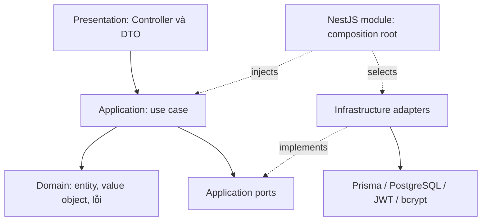

# Kiến trúc hệ thống

[Mục lục](README.md) · [README dự án](../../README.md)

## 1. Kiểu kiến trúc và lý do lựa chọn

SA Bank Account là modular monolith: một ứng dụng NestJS chứa ba module nghiệp vụ và dùng chung một PostgreSQL. Mỗi module được tổ chức thành presentation, application, domain và infrastructure, với port/adapter tại ranh giới phụ thuộc.

Cách tổ chức này phù hợp phạm vi Pha 1: dễ triển khai và truy vết một request, trong khi nghiệp vụ vẫn được tách khỏi web framework và ORM. Giao dịch chuyển tiền có thể bao trùm cả hai tài khoản trong một DB transaction; chưa cần giải quyết giao dịch phân tán giữa nhiều service.

Đổi lại, các module dùng chung database và triển khai cùng ứng dụng. Việc có nhiều thư mục module không có nghĩa là hệ thống đã là microservices hoặc các module đã độc lập hoàn toàn về dữ liệu.

## 2. Ranh giới module

| Module | Thành phần chính | Trách nhiệm |
| --- | --- | --- |
| identity | AuthController; RegisterUserUseCase; LoginUseCase | Đăng ký, xác thực mật khẩu, trả JWT |
| accounts | AccountsController; Open/List/Get/CloseAccountUseCase | Quản lý vòng đời tài khoản |
| money-movement | TransactionController; TransfersController; Deposit/Withdraw/Transfer/GetTransactionHistoryUseCase | Điều phối tiền và lịch sử |
| common | Money, AccessTokenGuard, filter, pipe, interceptor, logger | Quy ước dùng chung xuyên module |
| infrastructure/prisma | PrismaService, PrismaModule | Cung cấp kết nối DB và Prisma Client |

[AppModule](../../src/app.module.ts) chỉ ghép ba module nghiệp vụ trên. `staff-support` chưa được ghép thành tính năng. `ResolveRecipientUseCase` có file nguồn nhưng chưa được đăng ký thành endpoint; API công khai hiện không có route tra cứu người nhận riêng.

## 3. Trách nhiệm từng lớp



Presentation nhận body/path/query, kiểm tra định dạng, lấy `user.sub` từ JWT và ánh xạ kết quả ra HTTP. Application quyết định ai được thao tác, điều kiện số dư/trạng thái, thứ tự thao tác và replay. Domain chứa khái niệm chung như `Money` và lỗi nghiệp vụ. Infrastructure hiện thực các port bằng công nghệ cụ thể.

Ví dụ, `TransferMoneyUseCase` nhận `UnitOfWorkPort`; `MoneyMovementModule` cung cấp `PrismaUnitOfWork` qua token `UNIT_OF_WORK`. Test có thể thay bằng fake mà không cần PostgreSQL. Tuy vậy, fake không chứng minh được row lock hoặc constraint; các đặc tính này cần integration test.

`Money` ở `common/domain` vì cả tài khoản và giao dịch đều dùng nó. Nó dùng `bigint`, bất biến khi cộng/trừ và serialize thành string. Giới hạn 18 chữ số được kiểm tra bởi DTO/use case và cột DB; bản thân `Money` không áp giới hạn này cho mọi phép toán.

## 4. Luồng HTTP và bảo mật

1. Middleware gắn request ID để liên kết response và log.
2. Guard toàn cục kiểm tra Bearer token, ngoại trừ route `@Public()`.
3. Validation pipe chuyển query sang kiểu mong đợi, kiểm tra DTO và từ chối field ngoài hợp đồng.
4. Controller lấy danh tính đã xác thực, gọi use case.
5. Use case kiểm tra ownership và điều kiện nghiệp vụ, gọi port để đọc/ghi.
6. Interceptor bọc dữ liệu thành envelope; lỗi đi qua exception filter. HTTP logging interceptor ghi thông tin request.

Đây là luồng khái niệm; interceptor bao quanh xử lý controller. Filter chỉ ánh xạ lỗi sang HTTP, không chịu trách nhiệm rollback. Khi callback transaction thất bại, Prisma rollback trước khi lỗi được trả về client.

Domain error trong dự án kế thừa `AppError`, có `errorCode` và `httpStatus`. Vì vậy việc tách framework/ORM không đồng nghĩa với việc domain hoàn toàn không biết quy ước HTTP. Đây là một điểm cần cân nhắc nếu muốn tách domain nghiêm ngặt hơn về sau.

## 5. Luồng chuyển khoản

```mermaid
sequenceDiagram
    participant C as Client
    participant H as TransfersController
    participant U as TransferMoneyUseCase
    participant W as PrismaUnitOfWork
    participant D as PostgreSQL
    C->>H: POST /transfers + JWT + Idempotency-Key
    H->>U: command + initiatedByUserId
    U->>W: execute(callback)
    W->>D: BEGIN
    U->>D: Tra đích theo số tài khoản
    U->>D: FOR UPDATE hai tài khoản theo ID tăng dần
    U->>U: Kiểm tra nguồn thuộc người gọi
    U->>D: Tìm transfer theo nguồn + key
    alt Đã có transfer
        D-->>U: Kết quả đã ghi
    else Chuyển mới
        U->>U: Kiểm tra trạng thái, số dư và giới hạn tiền
        U->>D: Cập nhật hai số dư, tạo Transfer, DEBIT và CREDIT
    end
    W->>D: COMMIT; nếu có lỗi thì ROLLBACK
    U-->>H: transfer + isReplay
    H-->>C: 201 mới hoặc 200 replay
```

Các mũi tên từ use case tới DB biểu diễn thao tác qua transaction context do unit of work cung cấp; use case không import Prisma. Khóa theo cùng thứ tự ID giảm nguy cơ deadlock khi A→B và B→A chạy đồng thời. Các request tranh chấp cùng tài khoản phải chờ khóa, nên đây cũng là điểm có thể giới hạn throughput.

Đường ghi chuyển khoản sử dụng trực tiếp các port trong unit of work để thao tác hai tài khoản trong cùng transaction; nó không gọi HTTP của module accounts. Truy vấn lịch sử dùng `TransactionQueryPort` riêng, không cần khóa ghi tài khoản.

## 6. Quyết định nhất quán và giới hạn

| Tình huống | Cơ chế |
| --- | --- |
| Hai lần rút cùng số dư | Khóa dòng, đọc số dư trong transaction rồi kiểm tra |
| Lỗi giữa trừ nguồn và cộng đích | Toàn bộ cập nhật và lịch sử rollback |
| Retry transfer | Khóa dòng nguồn kết hợp unique `(source, key)` và đọc kết quả cũ |
| Đóng tài khoản đồng thời nạp tiền | UPDATE có điều kiện owner, ACTIVE và balance = 0; nếu không cập nhật được thì đọc lại |
| Mở tài khoản có tiền ban đầu | Tạo account và OPENING_DEPOSIT trong một transaction |

Không cấu hình isolation level riêng trong `PrismaUnitOfWork`; triển khai dựa vào transaction mặc định của DB kết hợp row lock. Chưa có cơ chế retry tự động chung cho deadlock/timeout, queue, outbox hay transaction phân tán.

API giao dịch không cho sửa/xóa lịch sử, nhưng chưa có trigger cấm mọi UPDATE/DELETE tại DB. Healthcheck Docker hiện là liveness qua route bảo vệ, không thay thế readiness kiểm tra DB. Xem [nghiệp vụ](04-business-rules.md) và [kiểm thử](06-testing.md) để hiểu các giới hạn này.

## 7. Điểm bắt đầu đọc mã

- [Bootstrap HTTP](../../src/main.ts) và [AppModule](../../src/app.module.ts).
- [MoneyMovementModule](../../src/modules/money-movement/money-movement.module.ts): cấu hình DI.
- [TransferMoneyUseCase](../../src/modules/money-movement/application/use-cases/transfer-money.use-case.ts): điều phối chuyển tiền.
- [PrismaUnitOfWork](../../src/modules/money-movement/infrastructure/persistence/prisma-unit-of-work.ts): transaction context và khóa dòng.
- [PrismaAccountRepository](../../src/modules/accounts/infrastructure/persistence/prisma-account.repository.ts): mở/đóng tài khoản.
