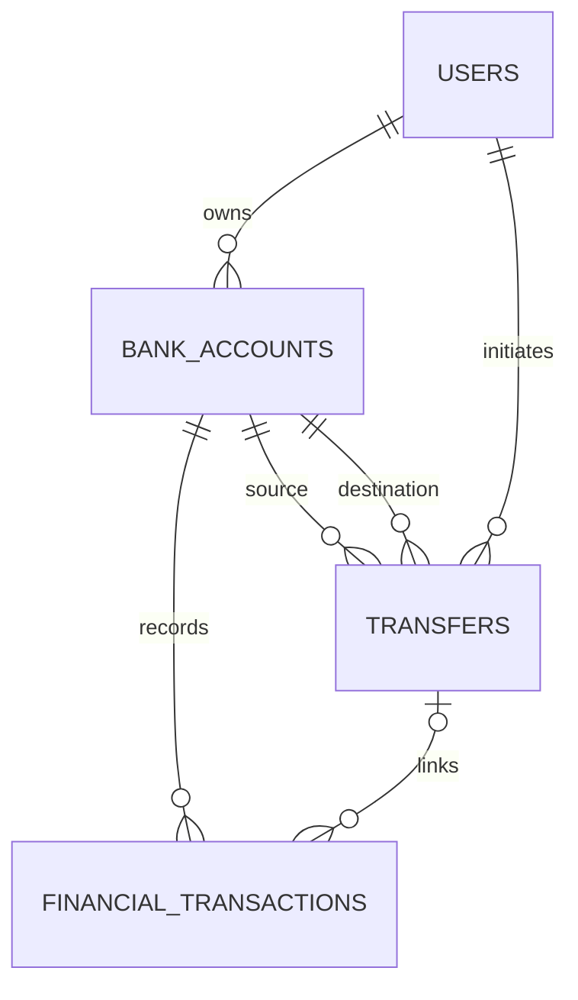

# Database

[Mục lục](README.md) · [README dự án](../../README.md)

## 1. Mô hình dữ liệu

PostgreSQL lưu bốn bảng chính. [Prisma schema](../../prisma/schema.prisma) ánh xạ tên camelCase trong mã sang snake_case trong SQL. ID được tạo theo định dạng UUID ở Prisma, khai báo bằng `String` trong schema và lưu bằng kiểu TEXT trong migration ban đầu.

Một transfer thành công được use case ghi thành đúng hai FinancialTransaction: DEBIT nguồn và CREDIT đích. Cardinality trên sơ đồ phản ánh quan hệ lưu trữ; database không có constraint đếm bắt buộc đủ hai dòng.

## 2. Từ điển dữ liệu

### users

| Cột SQL | Kiểu / ràng buộc | Ý nghĩa |
| --- | --- | --- |
| user_id | TEXT, PK | ID người dùng |
| email | VARCHAR(254), unique | Email đã trim và lowercase |
| full_name | VARCHAR(100) | Tên hiển thị |
| password_hash | VARCHAR(255) | Bcrypt hash, không trả ra API |
| created_at, updated_at | TIMESTAMPTZ | Thời điểm tạo/cập nhật |

### bank_accounts

| Cột SQL | Kiểu / ràng buộc | Ý nghĩa |
| --- | --- | --- |
| id, user_id | TEXT; PK và FK → users | ID tài khoản và chủ sở hữu |
| account_number | VARCHAR(20), unique | Số tài khoản giao tiếp với người dùng; bộ sinh hiện tạo 12 chữ số |
| account_name | VARCHAR(100) | Tên người dùng đặt |
| account_type | PAYMENT / SAVINGS | Loại tài khoản |
| current_balance | DECIMAL(18,0), default 0 | Số dư VND hiện tại |
| currency | CHAR(3), default VND | Chỉ chấp nhận VND |
| status | ACTIVE / CLOSED | Trạng thái vòng đời |
| closed_at | TIMESTAMPTZ, nullable | Có giá trị khi và chỉ khi CLOSED |
| created_at, updated_at | TIMESTAMPTZ | Thời điểm tạo/cập nhật |

Số tài khoản được sinh ngẫu nhiên, pad đủ 12 chữ số. Khi unique conflict, repository thử lại trong giới hạn 5 lần. Đóng tài khoản thay status/closed_at; không xóa dòng.

### financial_transactions

| Cột SQL | Kiểu / ràng buộc | Ý nghĩa |
| --- | --- | --- |
| id | TEXT, PK | ID giao dịch |
| account_id | TEXT, FK → bank_accounts | Tài khoản bị thay đổi số dư |
| transfer_id | TEXT, nullable, FK → transfers | Lệnh chuyển tiền liên quan, null với nạp/rút trực tiếp |
| transaction_type | CREDIT / DEBIT | Chiều tăng/giảm tiền |
| reference_type | Enum, xem bảng dưới | Nguồn gốc nghiệp vụ |
| amount | DECIMAL(18,0), > 0 | Số tiền giao dịch, luôn dương |
| balance_after | DECIMAL(18,0), >= 0 | Số dư tài khoản ngay sau giao dịch |
| status | COMPLETED | Trạng thái duy nhất hiện có |
| description | VARCHAR(250), nullable | Diễn giải |
| created_at | TIMESTAMPTZ | Thời điểm ghi nhận |

| transaction_type | reference_type hợp lệ |
| --- | --- |
| CREDIT | OPENING_DEPOSIT, CASH_DEPOSIT, TRANSFER_IN |
| DEBIT | CASH_WITHDRAWAL, TRANSFER_OUT |

Tiền gửi ban đầu bằng 0 không tạo OPENING_DEPOSIT, vì amount giao dịch phải dương. Lịch sử lưu `balance_after` để đối chiếu diễn biến số dư; nó không phải số dư hiện tại tại thời điểm đọc lịch sử.

### transfers

| Cột SQL | Kiểu / ràng buộc | Ý nghĩa |
| --- | --- | --- |
| id | TEXT, PK | ID lệnh chuyển tiền |
| source_account_id, destination_account_id | TEXT, FK → bank_accounts | Tài khoản nguồn và đích, phải khác nhau |
| initiated_by_user_id | TEXT, FK → users | Người gửi lệnh; ownership được use case kiểm tra |
| amount | DECIMAL(18,0), > 0 | Số tiền chuyển |
| description | VARCHAR(250), nullable | Nội dung |
| idempotency_key | VARCHAR(128) | Khóa retry do client gửi |
| status | COMPLETED | Chỉ lưu chuyển khoản hoàn tất |
| created_at | TIMESTAMPTZ | Thời điểm ghi nhận |

Bảng lưu các transfer COMPLETED. Khi xử lý thất bại, transaction rollback và không lưu bản ghi transfer.

## 3. Khóa, index và CHECK constraint

| Cơ chế | Vai trò |
| --- | --- |
| Unique users.email | Ngăn trùng email đã chuẩn hóa |
| Unique bank_accounts.account_number | Ngăn trùng số tài khoản |
| Unique `(source_account_id, idempotency_key)` | Không lưu hai transfer cùng nguồn và key |
| Unique `(transfer_id, transaction_type)` | Tối đa một DEBIT và một CREDIT cho mỗi transfer |
| Index account `(user_id, status, created_at DESC)` | Hỗ trợ danh sách tài khoản theo chủ/trạng thái |
| Index transaction `(account_id, created_at DESC, id DESC)` | Hỗ trợ lịch sử theo tài khoản và thứ tự ổn định |

Các giao dịch không có `transfer_id` vẫn được ghi nhiều lần vì unique của PostgreSQL cho phép nhiều giá trị NULL. Khóa ngoại từ account tới user, transaction tới account và transfer tới các account/user dùng `onDelete: Restrict`. Quan hệ tùy chọn transaction → transfer dùng ON DELETE SET NULL trong migration ban đầu.

Migration [add_domain_check_constraints](../../prisma/migrations/20261020000000_add_domain_check_constraints/migration.sql) thêm 9 CHECK:

1. Email bằng giá trị sau trim/lowercase.
2. Số dư tài khoản không âm.
3. Currency bằng VND.
4. CLOSED tương đương `closed_at IS NOT NULL`.
5. Amount giao dịch lớn hơn 0.
6. `balance_after` không âm.
7. Cặp transaction_type/reference_type hợp lệ.
8. Amount chuyển khoản lớn hơn 0.
9. Nguồn và đích chuyển khoản khác nhau.

Các CHECK được định nghĩa trong SQL migration. Chúng kiểm tra cả dữ liệu hiện có khi áp dụng; dữ liệu vi phạm làm migration thất bại thay vì tự sửa tiền.

## 4. Phân chia kiểm tra dữ liệu giữa database và nghiệp vụ

Database kiểm tra quan hệ bằng FK, tính duy nhất bằng unique và điều kiện trên từng dòng bằng CHECK. Use case thực hiện quy tắc bảo toàn tổng tiền, tạo hai dòng đối ứng có cùng amount với transfer và ghi `balance_after` theo số dư cập nhật. Các thao tác này nằm trong cùng transaction.

Ứng dụng cung cấp thao tác ghi và đọc lịch sử, không cung cấp API sửa/xóa. Database không có trigger chặn UPDATE/DELETE lịch sử; người có quyền SQL tương ứng vẫn có thể thay đổi các bản ghi.

`DECIMAL(18,0)` lưu số nguyên chính xác; JSON dùng string để tránh vượt vùng số nguyên an toàn của JavaScript. Client không chuyển tiền sang `number` để tính toán. Ngày giờ lưu TIMESTAMPTZ và response dùng chuỗi ISO; nên gửi bộ lọc thời gian có múi giờ rõ ràng.

## 5. Transaction và migration

Mở tài khoản có tiền ban đầu ghi account + OPENING_DEPOSIT trong một transaction. Nạp/rút khóa account, cập nhật balance và thêm transaction. Chuyển tiền khóa hai account, cập nhật hai balance, thêm transfer và hai transaction trong cùng unit of work.

Chạy migration hiện có bằng `npx prisma migrate deploy` sau khi cấu hình đúng DATABASE_URL; Compose đã có service `migrate` làm bước này. Không thay thế bằng `prisma db push` nếu cần cả CHECK constraint trong SQL migration. `npx prisma generate` chỉ sinh client, không áp dụng schema lên database.

Chi tiết triển khai: [PrismaAccountRepository](../../src/modules/accounts/infrastructure/persistence/prisma-account.repository.ts), [PrismaUnitOfWork](../../src/modules/money-movement/infrastructure/persistence/prisma-unit-of-work.ts). Hướng dẫn kiểm tra constraint: [tài liệu hiện có](../database-check-constraints.md). Cách chuẩn bị DB test: [kiểm thử](06-testing.md).
