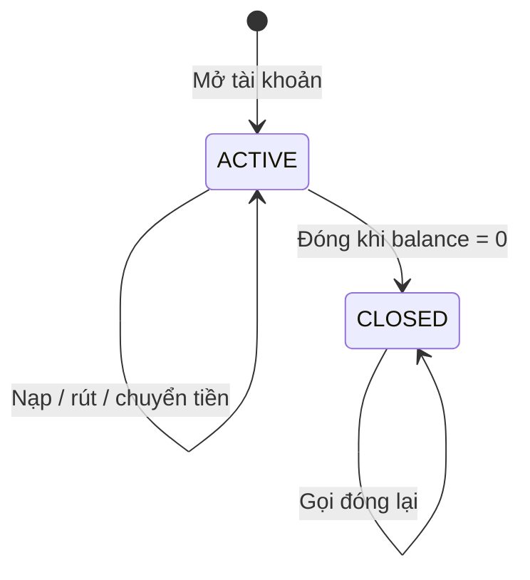

# Nghiệp vụ và quy tắc xử lý

[Mục lục](README.md) · [README dự án](../../README.md)

## 1. Tác nhân và phạm vi

Tác nhân hiện tại là khách hàng sử dụng REST API. Một khách hàng có thể mở nhiều tài khoản; mỗi tài khoản thuộc đúng một khách hàng. Nguồn chuyển khoản phải thuộc người gọi, đích có thể thuộc khách hàng khác.

Nạp, rút và tiền gửi ban đầu là thao tác mô phỏng, không có đối soát tiền mặt, cổng thanh toán hoặc phê duyệt nhân viên. Loại SAVINGS chưa có kỳ hạn/lãi suất hay hạn chế rút riêng. Vì vậy các thao tác này không thể được hiểu như một hệ thống ngân hàng thực đã tích hợp dòng tiền bên ngoài.

## 2. Danh sách use case

| Use case | Đầu vào/điều kiện | Xử lý và kết quả |
| --- | --- | --- |
| UC-01 Đăng ký | Tên, email, mật khẩu, xác nhận mật khẩu hợp lệ | Kiểm tra xác nhận, chuẩn hóa email, kiểm tra trùng, băm mật khẩu, tạo user; 201 |
| UC-02 Đăng nhập | Email và mật khẩu | Kiểm tra hash, trả access token và user; sai email/mật khẩu cùng lỗi 401 |
| UC-03 Mở tài khoản | JWT, tên, loại, tiền gửi ban đầu >= 0 | Sinh số tài khoản, tạo ACTIVE; nếu tiền ban đầu > 0 thì ghi OPENING_DEPOSIT; 201 |
| UC-04 Xem tài khoản | JWT và quyền sở hữu | Danh sách phân trang hoặc chi tiết; không thuộc mình trả 404 |
| UC-05 Nạp/rút | Tài khoản ACTIVE thuộc mình, amount > 0 | Khóa dòng, kiểm tra tiền, cập nhật số dư và lịch sử; 201 |
| UC-06 Xem lịch sử | Tài khoản thuộc mình | Lọc, phân trang; tài khoản CLOSED vẫn xem được |
| UC-07 Đóng tài khoản | Tài khoản thuộc mình, balance = 0 | Chuyển CLOSED và lưu closed_at; gọi lại vẫn 204 |
| UC-08 Chuyển khoản | Nguồn thuộc mình, đích hợp lệ, amount > 0, key hợp lệ | Atomic transfer và hai bút toán; 201 mới hoặc 200 replay |

Định dạng đầu vào và response ở [API](03-api.md). Việc email được chuẩn hóa trong use case không có nghĩa mọi chuỗi email có khoảng trắng ngoài đều qua HTTP validation; client nên gửi email hợp lệ, không có khoảng trắng thừa.

## 3. Vòng đời tài khoản

Không có nghiệp vụ mở lại tài khoản CLOSED. Xem chi tiết và lịch sử vẫn được phép với chủ sở hữu. Giao dịch mới trên nguồn đã đóng bị từ chối `409 ACCOUNT_NOT_ACTIVE`; đích chuyển tiền đã đóng được xem là không khả dụng và trả `404 ACCOUNT_NOT_FOUND`.

Đóng tài khoản dùng UPDATE có điều kiện `id + userId + ACTIVE + currentBalance = 0`. Nếu dữ liệu thay đổi giữa lúc đọc và ghi, use case đọc lại để phân biệt đã đóng hay vừa có tiền. Điều này tránh chỉ dựa vào một số dư cũ đã đọc trước đó.

## 4. Quy tắc tiền và ghi lịch sử

Tiền là số nguyên VND, không dùng float. Giao dịch amount > 0; opening deposit được bằng 0. Không cho thấu chi; rút/chuyển chỉ thành công khi số dư nguồn đủ. Nạp/chuyển vào phải không làm số dư đích vượt `999999999999999999`.

| Thao tác | Chiều | Reference | Tác động số dư |
| --- | --- | --- | --- |
| Mở có tiền | CREDIT | OPENING_DEPOSIT | Khởi tạo bằng số tiền gửi |
| Nạp | CREDIT | CASH_DEPOSIT | Cộng amount |
| Rút | DEBIT | CASH_WITHDRAWAL | Trừ amount |
| Chuyển đi | DEBIT | TRANSFER_OUT | Trừ amount ở nguồn |
| Nhận chuyển | CREDIT | TRANSFER_IN | Cộng amount ở đích |

Một transfer phải ghi hai giao dịch cùng `transferId`. Mọi thay đổi thuộc transfer cùng commit hoặc rollback. Ví dụ A = 500.000, B = 200.000, chuyển 100.000 thì A = 400.000, B = 300.000; tổng vẫn 700.000. Nếu lỗi trước commit, hai số dư và các bản ghi phải giữ như trước lệnh.

Lịch sử chỉ chứa giao dịch COMPLETED. Không có API chỉnh sửa hoặc xóa lịch sử. `balanceAfter` là dấu vết số dư sau từng giao dịch; tài khoản bị đóng không làm mất lịch sử này.

## 5. Đồng thời và retry

Nếu tài khoản có 100.000 và hai request cùng rút 80.000, khóa dòng khiến request sau đọc trạng thái sau khi request trước hoàn tất. Theo thiết kế, chỉ một request thành công, request còn lại báo thiếu tiền; số dư cuối là 20.000.

Chuyển khoản khóa hai account theo ID tăng dần, bất kể chiều chuyển. Các request trên cùng tài khoản được tuần tự hóa ở hàng dữ liệu, không khóa toàn bộ hệ thống.

Client tạo `Idempotency-Key` 16–128 ký tự cho mỗi ý định chuyển khoản mới, giữ nguyên key và payload khi gửi lại sau timeout. Khóa có phạm vi theo tài khoản nguồn, không phải toàn bộ người dùng. Chưa có thời hạn hết hiệu lực key trong schema hiện tại.

Thứ tự replay hiện tại cần hiểu chính xác:

1. Tra đích bằng số tài khoản và loại trường hợp nguồn trùng đích.
2. Khóa hai account, xác minh quyền sở hữu nguồn.
3. Tra transfer cũ theo nguồn và key; nếu có thì trả kết quả cũ.
4. Chỉ với transfer mới mới kiểm tra trạng thái nguồn/đích, số dư và thực hiện ghi.

Vì vậy replay cùng payload vẫn có thể thành công sau khi nguồn hoặc đích đã đóng. Nhưng đây không phải cơ chế trả kết quả cũ bất kể payload: đổi đích sang số không tồn tại hoặc nguồn trùng đích có thể lỗi trước bước tìm key. Nếu payload thay đổi nhưng vượt các bước đầu, hệ thống có thể trả transfer cũ mà không báo xung đột. Class `IdempotencyKeyReusedError` có trong mã nhưng chưa được gọi trong luồng transfer.

Nạp/rút chưa có idempotency key; gửi lại POST có thể tạo giao dịch mới. Mở tài khoản cũng không có chống lặp theo key. Khi không rõ request đã hoàn tất hay chưa, cần kiểm tra dữ liệu/lịch sử trước khi thao tác lại; không giả định mọi POST đều chống lặp.

## 6. Kịch bản demo có kết quả mong đợi

| Bước | Thao tác | Kết quả mong đợi |
| --- | --- | --- |
| 1 | Đăng ký và đăng nhập A | Nhận JWT |
| 2 | Mở tài khoản A với 500000, B với 0 | Hai account ACTIVE; A có opening transaction |
| 3 | Nạp 100000 vào A | A = 600000 |
| 4 | Rút 50000 từ A | A = 550000 |
| 5 | Chuyển 150000 từ A sang B với key K | A = 400000, B = 150000; 201 |
| 6 | Gửi lại bước 5 cùng K và payload | 200; không thêm chuyển khoản hay đổi số dư |
| 7 | Đọc lịch sử A/B | Có TRANSFER_OUT/TRANSFER_IN cùng transferId |
| 8 | Thử đóng A khi còn 400000 | 409 ACCOUNT_HAS_BALANCE |
| 9 | Rút 400000, đóng A, đóng lại A | Số dư 0; cả hai lần đóng trả 204 |
| 10 | Thử nạp vào A đã đóng | 409 ACCOUNT_NOT_ACTIVE |

Có thể tạo B dưới user thứ hai để kiểm tra chuyển khác chủ. Khi đó mọi thao tác xem/nạp/rút trên B phải dùng JWT của chủ B. Dùng token A xem B phải nhận 404, trong khi chuyển A→B vẫn được phép.

## 7. Ngoài phạm vi hiện tại

Chưa có hoàn tiền, hủy giao dịch, lãi suất, phí, kiểm tra hạn mức theo ngày, KYC, duyệt giao dịch, nhân viên, đa tiền tệ, ledger bất biến ở cấp DB hoặc lưu lịch sử lệnh thất bại. Đây là hướng mở rộng, không phải cam kết hành vi của Pha 1.
